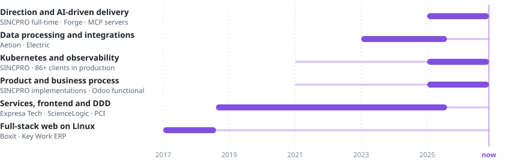
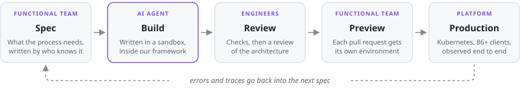

# Andres Gutierrez

**Principal Software Engineer at [SINCPRO](https://sincpro.dev)** · Cochabamba, Bolivia ·
remote with US and Canadian teams since 2019

I came into software as the industry moved from server-rendered monoliths to the cloud, and I
have worked through each shift since. Each one added a layer instead of replacing the last, so
today I see the whole system: the business process, the code, the infrastructure and how it
runs in production.

<picture>
  <source media="(prefers-color-scheme: dark)" srcset="assets/layers-dark.svg">
  
</picture>

That is what I bring as an architect now that AI writes most of the code. At SINCPRO I lead 6
engineers and 5 functional consultants, and my job is deciding what to build, how it fits
together, and keeping it secure and running for 86+ clients in production.

## How a change ships today

The agent writes the code. People decide what to build, review how it fits and test it against
the real process.

<picture>
  <source media="(prefers-color-scheme: dark)" srcset="assets/loop-dark.svg">
  
</picture>

## How I got here

**Full-stack web on Linux · 2017.** Django apps for a retailer, and a desktop ERP moved to the
web for a Peruvian vendor, with e-invoicing for SUNAT, Peru's tax authority, signed and sent
over SOAP. My first ERP.

**Services, DDD and CQRS · 2018.** I joined US product teams through Jalasoft. On a survey
platform we used DDD and CQRS over RabbitMQ to absorb traffic peaks. At ScienceLogic, which
monitors networks and data centers for large enterprises, the client named me technical lead
of the core platform while it moved from batch monoliths to microservices.

**Kubernetes, the business and cloud data · 2021.** Two tracks at once. At SINCPRO I built the
Kubernetes platform and its observability, and I learned the business side: as a certified
Odoo functional implementer I sit with finance, imports and HR teams, map the process, and then
build and run the software for it. Through Encora I worked inside US and Canadian product
teams: synthetic health data on Ray and Spark at Aetion, an event-driven JumpCloud sync on AWS
at Electric.

**AI-driven delivery · 2025.** It started with simple tools. Writing code got cheap, so the
hard part moved to the spec, the architecture, the review and running it all in production. We
first gave coding agents our rules and domain knowledge through MCP servers, then turned that
into Forge. Today agents write most of our code from written specs, inside our own frameworks
and review gates, and my work is the platform around them.

## What I work on now

- **Frameworks.** One architecture (DDD, hexagonal, CQRS) for every Python service, web app and
  offline-first mobile app, with logs, metrics and traces wired in from the first commit.
- **Platform.** Kubernetes (RKE2) for 86+ clients in production: Kong gateway, staging, UAT and
  production deploys, and on-premise nodes for clients who keep their data on their own
  servers. Prometheus, Loki, Tempo, Grafana and GlitchTip watch all of it.
- **Forge** (internal, alpha). Implementers, functional consultants and client teams ask for a
  change from the AI assistant they already use, a web UI or an API. Agents build it in
  isolated sandboxes, and what comes back is a verified pull request with its own preview
  environment.

## The platform, in the open

| Repository | What it is | Package |
|---|---|---|
| [sincpro_framework](https://github.com/Sincpro-SRL/sincpro_framework) | Application layer for Python services: commands, features, bounded contexts | [PyPI](https://pypi.org/project/sincpro-framework/) |
| [sincpro_client_framework](https://github.com/Sincpro-SRL/sincpro_client_framework) | The same application layer in TypeScript, for web, React Native and scripts | [npm](https://www.npmjs.com/package/@sincpro/client-framework) |
| [sincpro_criteria](https://github.com/Sincpro-SRL/sincpro_criteria) | One query object (filter, order, page) shared by the TypeScript clients and the Python services | [npm](https://www.npmjs.com/package/@sincpro/criteria) |
| [sincpro_mobile](https://github.com/Sincpro-SRL/sincpro_mobile) | Offline-first framework for enterprise React Native / Expo apps | [npm](https://www.npmjs.com/package/@sincpro/mobile) |
| [sincpro_web_framework](https://github.com/Sincpro-SRL/sincpro_web_framework) | Enterprise web apps, with [web-ui](https://github.com/Sincpro-SRL/sincpro_web_ui) and [web-composer](https://github.com/Sincpro-SRL/sincpro_web_composer) | [npm](https://www.npmjs.com/package/@sincpro/web-framework) |
| [cups_http_gateway](https://github.com/Sincpro-SRL/cups_http_gateway) | A JSON/HTTP gateway to CUPS print servers, in Rust | |

## What I hold to

- **Architecture is what keeps AI-written code maintainable.** The agent writes the code; the
  framework decides where it goes.
- **If it runs in production, it reports.** Logs, metrics and traces come with the template,
  not after the first incident.
- **The person who knows the process tests the change.** Every pull request gets its own
  environment where the functional team tries it before release.

[LinkedIn](https://www.linkedin.com/in/andres-gutierrez-97129a136) ·
andres.gutierrez@sincpro.com.bo
